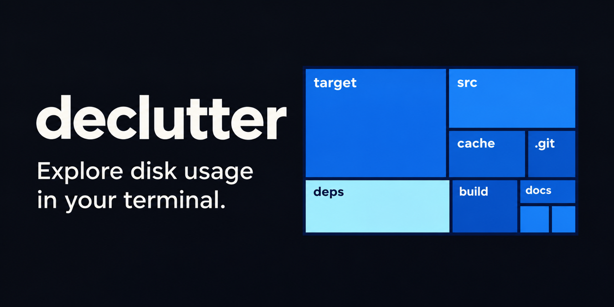

# Declutter - TUI Disk Space Analyzer



A terminal UI tool that visualizes disk space usage in the style of classic defragmentation utilities. Instead of defragmenting, it helps you identify temporary/build files (node_modules, .pycache, target, etc.) that consume significant disk space.

## Features

- **Visual Treemap Interface**: Displays folders as proportionally-sized colored blocks in a grid
- **Smart Classification**: Automatically identifies temporary files (node_modules, target, build, etc.)
- **Color-Coded Display**:
  - Bold blue: Real/source files
  - Light blue: Temporary files
  - Yellow border: Selected item
- **Interactive Navigation**: Browse directories with arrow keys
- **Inspector View**: Detailed statistics for any directory
- **Fast Scanning**: Uses parallel directory traversal with jwalk

## Build and install from source

On macOS or Linux, run these commands from the project directory with Rust, Cargo, a native linker, and Make installed.

```sh
make test
make install
~/.local/bin/declutter /path/to/folder
```

The default install location is `~/.local/bin`. Add that directory to your `PATH` to run `declutter` from anywhere. Use `make install PREFIX=/your/prefix` to choose another location. To build without installing, use `cargo build --release --locked` and run `./target/release/declutter`.

## Package a release

Run `make package` on each platform you distribute. It creates a versioned archive in `dist/` with the Rust target in its name. Apple Silicon macOS, Intel macOS, and Intel Linux correspond to `aarch64-apple-darwin`, `x86_64-apple-darwin`, and `x86_64-unknown-linux-gnu` respectively. For GNU/Linux releases, build on the oldest glibc baseline you intend to support.

On the receiving machine, extract the matching archive and run these commands inside its directory. The package includes the compiled executable and installer.

```sh
./install.sh
~/.local/bin/declutter
```

You can also run `./declutter` directly from the extracted folder. The installer accepts `PREFIX=/your/prefix ./install.sh`. To uninstall, remove the installed `bin/declutter` from the chosen prefix.

### Keyboard Controls

- **Arrow Keys** / **hjkl**: Select the neighboring block in that direction
- **f**: Show the selected folder’s direct files, largest first. Use **↑/↓** to scroll and **f**, **Esc**, or **Backspace** to return. In a folder with no subfolders, **f** lists the current folder’s files.
- **Space** / **Enter**: Open selected directory
- **Backspace** / **Esc**: Go up one directory, stopping at the starting folder
- **i**: Open inspector view for selected directory
- **Esc**: Close inspector view
- **q**: Quit application

## Configuration

Optional settings in `.declutter.toml` control temporary-file patterns, colors, scan depth, and directory worker count. The app looks in the current directory, then your home directory, and otherwise uses its built-in defaults.

## Scan cache

Declutter saves completed directory scans in one per-user SQLite file. On Linux the file is
`$XDG_CACHE_HOME/declutter/trees.sqlite3` (default `~/.cache/declutter/trees.sqlite3`).
On macOS it is `~/Library/Caches/declutter/trees.sqlite3`. The scanner skips its own
cache directory when indexing an ancestor.

Reopening a folder loads the freshest snapshot that covers it, including snapshots of
parent folders. Folders with up to 1,000 indexed files expire one minute after the scan
finishes. Larger folders expire after 15 minutes. Each subfolder uses its own recursive
file count and the original scan time. Changes on disk appear after a fresh scan.
Changing temporary-file patterns or the scan depth triggers a separate scan. If a
parent scan stopped too early to cover a subfolder, Declutter scans that subfolder
directly. If the cache is unavailable, Declutter still displays a live scan.

## Code layout

- `src/scanner/` walks the filesystem and classifies entries.
- `src/models/` defines the in-memory directory tree and selection.
- `src/app.rs` and `src/events/` handle navigation and keyboard input.
- `src/algorithms/` computes treemap geometry.
- `src/ui/` renders the explorer, file list, and inspector.
- `src/main.rs` connects the scanner and UI to the terminal.

## License

MIT

## Contributing

Contributions welcome! Please feel free to submit issues or pull requests.
